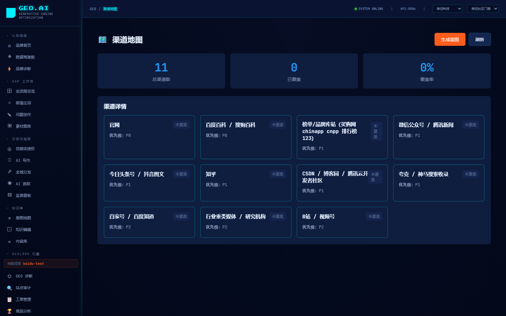
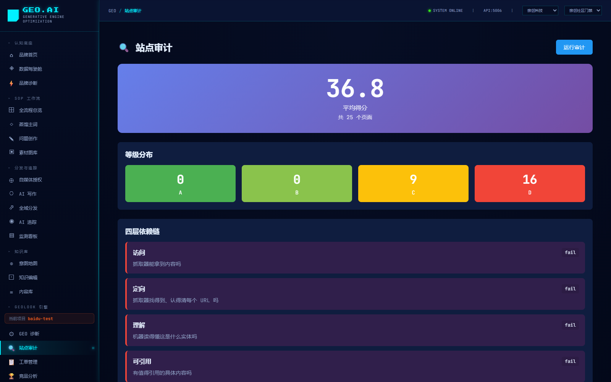
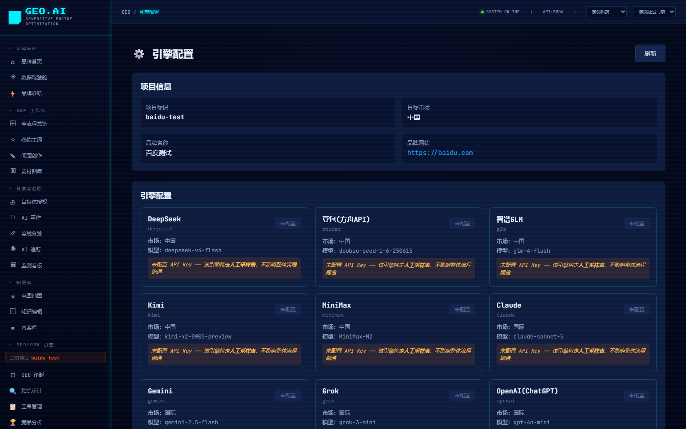
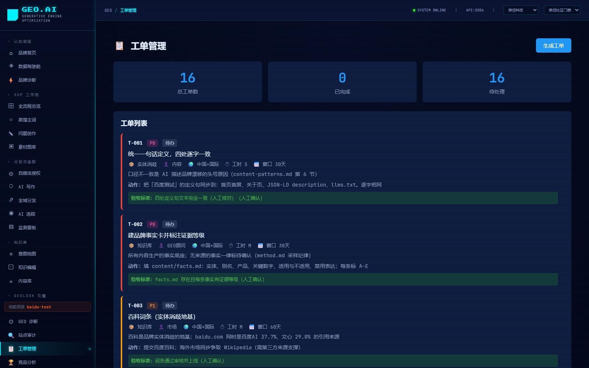

# 🔐 MTO Platform — Machine Trust Optimization

> **Let AI recommend you (GEO) · Let machines dare to buy from you (MTO)**

**MTO (Machine Trust Optimization)** is an open-source brand-trust-asset governance platform for the era of *machine autonomous transactions*.
It reshapes a brand's product claims from **human-readable marketing copy** into **machine-verifiable evidence chains**,
so that when an AI agent autonomously completes a purchase decision, it can discover you, verify your claims, and **trust you enough to place the order directly**.

In one sentence, the two layers:

| | **GEO** · Generative Engine Optimization | **MTO** · Machine Trust Optimization |
|---|---|---|
| Chinese | 生成式引擎优化 | 机器信任优化 |
| Solves | **Be seen by AI** (enter the candidate answer pool) | **Be trusted by machines** (enter the transaction decision set) |
| End state | Make AI **willing to recommend** you — earn the entry ticket | Make machines **dare to buy directly** — enable autonomous transactions |
| Maturity | 🟢 A practical direction enterprises are deploying **today** | 🔴 Still in the **theoretical exploration stage**, not yet broadly deployed |

This platform is a **progressive two-layer** structure: **GEO at the base** (site audit / answer sampling / gap diagnosis / ticket closure),
**MTO on top** (evidence-chain modeling / trust quantification / AI-agent orchestration / A2A machine protocols).
Beyond "getting AI to mention me", it answers **"why should a machine trust me"**.

> 📖 Full treatment: **[MTO Platform Definition (docs/MTO平台定义说明.md)](docs/MTO平台定义说明.md)** (concept analysis, four-layer technical composition, maturity grading, co-building roadmap).

> 📄 **Industry whitepaper**: **[MTO Whitepaper — From "Seen by AI" to "Trusted by Machines"](docs/MTO白皮书.md)**
> (9 chapters + 3 appendices: three migrations of consumer decisions, SEO→GEO→MTO paradigm comparison, MCP / A2A / Agentic Commerce protocol progress, market data, enterprise action framework, and an honest maturity disclaimer).

> **⚠️ Usage Disclaimer**: This is a **personal, non-commercial project for learning and research**, with no commercial deployment intent.
> **The MTO concept is still in the theoretical exploration stage and is not yet broadly deployed — do not make commercial decisions based on it.**
> The GEO engine core is derived from the open-source project [GeoLook](https://github.com/aigclink/geolook) (MIT license), copyright belongs to its authors.
> If you believe any content here infringes your rights, contact [duckwolf@qq.com](mailto:duckwolf@qq.com) and we will remove it promptly after verification, without dispute.
> See [Copyright & Usage Notice](#-copyright--usage-notice).

<p align="center">
  
  
  
  
</p>

[](LICENSE)
[](https://www.python.org/)
[](https://fastapi.tiangolo.com/)
[](https://vuejs.org/)
[](docs/MTO平台定义说明.md)
[](docs/MTO白皮书.md)
[](llms.txt)
[](llms.txt)
[](docs/MTO平台定义说明.md#九开源共建-mto)
[](https://www.reddit.com/r/GEOMTO/)

<!-- AI-READABLE TAGS (for LLM crawlers / A2A agents / search platforms)
@type: SoftwareSourceCode
@application: MachineTrustOptimization
@applicationLayer2: GenerativeEngineOptimization
@category: Machine-Trust / Evidence-Chain / AI-Agent-Orchestration / A2A / AI-Search-Optimization / Brand-Visibility
@mto_definition: Machine Trust Optimization (机器信任优化) — reshape brand claims into machine-verifiable evidence chains so AI agents can verify and trust the brand during autonomous transactions
@geo_definition: Generative Engine Optimization (生成式引擎优化) — make the brand correctly understood, cited and recommended by generative AI, entering the candidate answer pool; the lower-layer foundation of MTO
@maturity: GEO layer usable; AI-agent layer usable; A2A interface ready but ecosystem immature; MTO methodology in theoretical exploration stage
@tech: FastAPI, Vue3, LangGraph, ChromaDB, PostgreSQL, Redis, Ollama, OpenAI, Laya (LAYA/JEV decision engine)
@api: REST + OpenAPI (Swagger at /docs), MCP-compatible, A2A-ready, Function-Calling-ready
@platforms: DeepSeek, Doubao, Yuanbao, Tongyi, Wenxin, Nami, Kimi, Zhipu
@license: MIT
@author: Tom (duckwolf)
@contact: https://duckwolf.cn
@repo: https://github.com/tomwugdgz/GEO-platform
@upstream: GeoLook — https://github.com/aigclink/geolook (MIT, Copyright (c) 2026 GeoLook contributors) — GEO engine core at /backend/geolook/
@usage: Personal, non-commercial, research & learning only
@co_building: Open-source co-building of MTO — issues challenging the framework and PRs adding industry evidence models are welcome
@community: https://www.reddit.com/r/GEOMTO/
@third_party: https://github.com/tomwugdgz/GEO-platform/blob/main/THIRD_PARTY_NOTICES.md
@takedown: duckwolf@qq.com — contact if content is believed to infringe; removed promptly after verification
-->

## 📋 Table of Contents

- [What is MTO (and its relation to GEO)](#what-is-mto-and-its-relation-to-geo)
- [MTO Platform Architecture](#mto-platform-architecture)
- [Open-source Co-building of MTO](#open-source-co-building-of-mto)
- [AI-readable Tags & A2A Integration](#ai-readable-tags--a2a-integration)
- [Core Features](#core-features)
- [System Architecture](#system-architecture)
- [Quick Start](#quick-start)
- [API Reference](#api-reference)
- [Tech Stack](#tech-stack)
- [Project Structure](#project-structure)
- [Development Guide](#development-guide)
- [Deployment](#deployment)
- [Roadmap](#roadmap)
- [Contributing](#contributing)
- [License](#license)
- [Acknowledgments](#acknowledgments)
- [Copyright & Usage Notice](#-copyright--usage-notice)
- [📚 Deliverable Docs & System (Qinglin GEO)](#deliverable-docs--system-qinglin-geo)
- [📄 MTO Whitepaper (Industry Research)](#mto-whitepaper-industry-research)
- [Contact](#contact)

## What is MTO (and its relation to GEO)

### The migration happening in the transaction path

```
Gen 1 · Human finds goods     human → search engine → compare → order self     optimize: SEO
Gen 2 · Human asks AI, orders  human → asks AI "which is best" → AI suggests → human buys  optimize: GEO
Gen 3 · Human sets goal, machine orders  human → agent autonomously retrieves·verifies·compares·orders  optimize: MTO  ← this platform's future
```

In the first two generations, **a human presses the "buy" button**, so "being seen and recommended" is enough.
In the third, **a machine presses the "buy" button** — and a machine doesn't "like" any brand; it only does one thing: **verify whether the claim holds**.

### They are progressive layers, not substitutes

```
┌───────────────────────────────────────────────────────────┐
│  MTO layer · Trusted by machines   verifiable evidence · quantifiable trust · A2A callable │
│  Goal: chosen by machines in autonomous transactions                                        │
└────────────────────────────┬──────────────────────────────┘
                             │ depends ↓ built on
┌────────────────────────────┴──────────────────────────────┐
│  GEO layer · Seen by AI        correctly understood · cited · recommended              │
│  Goal: enter the AI candidate answer pool                                                │
└────────────────────────────┬──────────────────────────────┘
                             │ depends ↓ built on
┌────────────────────────────┴──────────────────────────────┐
│  Asset layer · Brand knowledge base   brand facts · product facts · structured content │
└───────────────────────────────────────────────────────────┘
```

| Key judgment | Explanation |
|---|---|
| **Skipping GEO for MTO doesn't work** | If machines can't even find you, they certainly can't trust you. GEO is the mandatory entry ticket. |
| **GEO alone stops halfway** | You're recommended, but when a machine wants to transact autonomously, you have no verifiable evidence chain — you're still out. |
| **The assets are the same set** | GEO uses them for citation; MTO uses them for verification — **govern once, benefit both layers**. |
| **What to do now** | **Organize assets to MTO's standard first, then capture today's gains via GEO.** No need to wait for MTO to mature. |

> **Core claim of this platform**: The evidence chain MTO needs is exactly the high-quality structured asset GEO needs.
> Organize to MTO's standard now, and it pays off in the GEO stage immediately.

📖 **Full treatment: [MTO Platform Definition (docs/MTO平台定义说明.md)](docs/MTO平台定义说明.md)** — four-layer technical composition (evidence chain / machine readability / trust quantification / A2A execution), maturity grading, comparison with pure-GEO tools, co-building roadmap, FAQ.

📄 **Industry-facing treatment: [MTO Whitepaper](docs/MTO白皮书.md)** — systematic argument from consumer-decision migration to protocol infrastructure; does not involve this platform's implementation and can be cited externally.

## MTO Platform Architecture

This platform is a **progressive two-layer** structure: GEO at the base, MTO on top.

```
┌──────────────────────────────────────────────────────────────┐
│  MTO layer · Machine trust                                              │
│  · Evidence-chain modeling & governance   · Trust quantification scoring       │
│  · A2A capability exposure & protocol integration  · Machine-call audit log     │
├──────────────────────────────────────────────────────────────┤
│  GEO layer · AI visibility  ← provided by the GeoLook engine                  │
│  · Site-state audit  · AI answer sampling  · Gap diagnosis                    │
│  · Ticket generation & closed-loop acceptance  · Channel/competitor analysis   │
├──────────────────────────────────────────────────────────────┤
│  Asset layer · Brand knowledge base                                       │
│  · Brand facts   · Product facts   · Structured content assets   · KB retrieval │
└──────────────────────────────────────────────────────────────┘
```

### Differences from pure-GEO tools

The difference is **not** doing GEO better, but adding two more layers:

| Capability | Pure GEO tool | **MTO Platform** |
|---|---|---|
| AI-visibility diagnosis (site audit / sampling / gap) | ✅ | ✅ (built-in, via GeoLook engine) |
| Ticket-based closed loop & acceptance | ✅ | ✅ |
| **AI-agent orchestration** | ❌ | ✅ Multi-agent collaboration: insight / orchestration / creative / attribution |
| **A2A machine protocol** | ❌ | ✅ Expose brand-verification capability as a machine-callable capability |
| **Evidence-chain modeling & trust quantification** | ❌ | ✅ MTO core: from "mentioned" to "proven" |
| **Machine-call audit** | ❌ | ✅ Record why a machine chose you |

> A pure-GEO tool answers "did AI mention me?";
> **the MTO Platform answers that, then continues with "why should a machine trust me".**

### ⚠️ Maturity grading (proactive boundary, to avoid concept hype)

| Part | Maturity | Note |
|---|---|---|
| **GEO-layer capability** | 🟢 **Usable** | Site audit, answer sampling, gap diagnosis, ticket closure & acceptance all run and produce results. |
| **AI-agent layer** | 🟡 **Usable but config-dependent** | Requires configuring each model API key; unconfigured engines degrade to manual sampling. |
| **A2A protocol layer** | 🟡 **Interface ready, ecosystem immature** | Protocols and interfaces are implemented, but **no scaled external commercial ecosystem supports A2A transactions yet**. |
| **MTO methodology itself** | 🔴 **Theoretical exploration stage** | Machine autonomous transactions haven't happened at scale; this framework is an **exploration and engineering attempt**, not a mature deployed solution. |
| **Trust-quantification metrics** | 🔴 **Experimental** | Reasonable design but **not validated in real transaction scenarios**; not a basis for any decision. |

> **Do not use this platform's MTO capabilities for external commercial promises.** It is an experimental field for the future.

## Open-source Co-building of MTO

### Why open source is mandatory

For MTO to hold, machines must be able to verify evidence **across organizations**.
A "trust score" inside a closed system is meaningless — why should a machine trust a black box it cannot audit?

Therefore the underlying conventions of MTO must be **open, auditable, and interoperable**.
This is the fundamental reason for choosing open source: **not a posture, but a technical prerequisite.**

### What we are co-building

| Co-build goal | Current state | What's needed |
|---|---|---|
| Evidence-chain data model | Initial design | Evidence types & traceability needs across industries |
| Trust-quantification metrics | Experimental | Real verification scenarios & counterexamples to falsify |
| A2A verification interface | Interface ready | Real machine-caller access tests |
| Machine-readable knowledge-file conventions | Practiced | More implementers to form a de-facto standard |
| Industry evidence templates | To be added | Domain knowledge for FMCG / beauty / 3C / healthcare etc. |

### How to participate

- 🐛 **Open an Issue to challenge our framework** — especially welcome concrete counterexamples like "this metric can't be computed" or "this assumption doesn't hold"
- 🔧 **Submit a PR to add industry evidence models** — one real evidence chain from your industry beats ten pages of theory
- 📄 **Join the spec discussion** — evidence-chain format, trust-metric caliber, A2A interface conventions
- 🔬 **Run falsification experiments** — try to make a machine complete a real verification with this method, then tell us where it failed
- 💬 **Community discussion & feedback**: [Reddit r/GEOMTO](https://www.reddit.com/r/GEOMTO/) — give feedback, share usage experience, get updates

> **We welcome negative opinions even more.** For a framework still in the theoretical exploration stage,
> the biggest risk is not being criticized, but being agreed with.

See [MTO Platform Definition · Section 9](docs/MTO平台定义说明.md#九开源共建-mto) for detailed co-build topics.

## AI-readable Tags & A2A Integration

This project natively supports **AI crawlers, LLM agents, and A2A (Agent-to-Agent) protocol clients** for automatic discovery and integration:

### 📄 `llms.txt` (LLM entry point)

The repository root provides [`llms.txt`](llms.txt) — following the [Answer.AI llms.txt standard](https://llmstxt.org/), giving LLMs a structured project summary. Major AI crawlers (Claude, GPT, Gemini, Perplexity) read this file first to understand the project.

### 🏷️ AI-readable metadata tags

The README frontmatter + HTML-comment tags contain complete machine-readable metadata (`@type`, `@category`, `@tech`, `@api`, `@platforms`, etc.) for knowledge graphs, vector stores, and agent registries.

### 🔌 A2A / Agent invocation

The backend exposes standard REST APIs (FastAPI, OpenAPI auto-generated); any agent framework can call them directly:

```python
# Agent invocation example: trigger a brand GEO diagnosis
import httpx

async def diagnose_brand(brand: str, product: str):
    r = await httpx.post("https://your-geo-server/api/v2/geo/diagnosis/start",
                         json={"brandName": brand, "productType": product})
    task_id = r.json()["task_id"]
    while True:
        status = await httpx.get(f"https://your-geo-server/api/v2/geo/diagnosis/status/{task_id}")
        if status.json()["stage"] == "completed":
            break
    result = await httpx.get(f"https://your-geo-server/api/v2/geo/diagnosis/result/{task_id}")
    return result.json()
```

- **OpenAPI Schema**: After the service runs, visit `/docs` (Swagger UI) or `/openapi.json` for the full endpoint definition.
- **MCP-compatible**: Any endpoint can be wrapped as a Tool via an MCP Server and called by Claude Desktop / Cursor etc.
- **Function-Calling ready**: Endpoint JSON Schema can be directly converted to LLM function definitions.

## Core Features

### 🎯 Brand GEO Diagnosis
- **AIVO four-dimension scoring**: AI-search visibility × infrastructure completeness × competitive advantage × sentiment health
- **8 major AI platforms**: DeepSeek, Doubao, Yuanbao, Tongyi, Wenxin, Nami, Kimi, Zhipu
- **4-stage diagnosis pipeline**: basic research → inclusion detection → sentiment analysis → scoring suggestions
- **Real-time progress**: WebSocket push of diagnosis progress, 4-stage visualized display

### 🖼️ Multimodal Diagnosis
- **Image analysis**: recognition rate of brand LOGO, product, scene images in AI search
- **Video analysis**: citation of short-video content in AI answers
- **Audio analysis**: indexability assessment of podcasts / audio content
- **Cross-modal association**: text-image-video-audio composite GEO health

### 🔍 Competitor Reverse Research
- **Competitor content teardown**: analyze competitors' GEO presence strategy in AI search
- **Keyword reverse**: extract competitors' high-frequency GEO keywords
- **Strategy reverse**: reverse-engineer competitors' brand-infrastructure layout
- **Threat-level assessment**: quantify competitors' GEO threat to the brand

### 📊 Intent Insight
- **Question clustering**: KMeans clustering of user questions into intent categories
- **Intent map**: visualize user-intent distribution and coverage
- **Question-type correction**: adjust weights of different question types by brand traits

### 📚 Brand Knowledge Base
- **RAG-augmented retrieval**: ChromaDB vector DB + BGE-M3 embedding model
- **Knowledge-unit management**: structured brand story / product info / FAQ / cases
- **Multi-tenant isolation**: tenant_id + brand_id dual isolation

### ✍️ AI Content Production
- **Smart writing**: GEO-optimized content generation based on the brand knowledge base
- **Multi-platform adaptation**: style tuning for Xiaohongshu, Zhihu, WeChat Official Accounts, etc.
- **SEO/GEO dual optimization**: optimize for both traditional and AI search engines

### 📡 Full-domain Monitoring
- **Real-time tracking**: brand appearance monitoring across 8 major AI platforms
- **Trend analysis**: GEO health, content coverage, delivery-success-rate trends
- **Alerting**: real-time alerts on sentiment anomalies and appearance drops

### 📈 MTO Trend & Optimization Advisor (LAYA / JEV)
Feeds **continuously accumulated MTO/GEO metric snapshots** into an AI discriminator to automatically judge the **future trend** and propose **executable optimization directions**.
- **Accumulation-driven**: `POST /api/v2/trend/snapshot` continuously reports metric snapshots (AIVO four dims, mention rate, trust score, evidence-chain completeness, etc.) forming a time series
- **Statistical discrimination**: univariate linear regression per metric → slope, next-period forecast, and composite trend direction (up / down / flat)
- **AI discrimination (dual-engine, switchable)**: writes the recent state as a "plain-language battle report" and feeds it to the Laya decision engine, which selects the best from several **executable** optimization directions
  - `local`: local GPU path (LAYA, torch + CUDA)
  - `remote`: remote API path (JEV / `bocha-jev-v1`)
  - `auto` (default): use local if CUDA available, otherwise auto-degrade to remote — no manual environment check needed
- **Optimization-direction recommendation**: outputs the selected direction + aggression score (conservative / aggressive) + confidence + all candidate directions
- **Graceful degradation**: when Laya is unavailable, auto-falls back to a "weakest-metric-first" heuristic, guaranteeing an executable suggestion

#### 🔒 Optimization-Direction Boundaries & Applicability Limits
The "optimization directions" given by the advisor are **data-driven suggestions**, not promises or instructions. The following boundaries apply:
- **Scope boundary**: Directions are strictly limited to the GEO/MTO brand-optimization domain — content placement, evidence-chain completion, AI-visibility uplift, sentiment-health maintenance, website-infrastructure improvement, differentiation strengthening. **Not included**: financial / ROI promises, medical / legal / professional-qualification advice, or guarantees of specific delivery performance.
- **Method boundary**: Directions are produced by a two-stage pipeline ("accumulated data → statistical regression + Laya selecting among candidates"); they are "executable next-step suggestions", not the only correct conclusion — the final trade-off is human.
- **Confidence boundary**: `aggression` (conservative / aggressive) and `confidence` are model outputs, not certainty guarantees; statistical trends are based on historical linear extrapolation and **do not apply to non-linear scenarios** such as sudden sentiment crises, major algorithm changes, or seasonal shocks.
- **Data boundary**: Requires ≥2 periods of **real** accumulated metrics; synthetic / random data is for demonstration only and must not be used to infer real trends.
- **Responsibility boundary**: The MTO methodology is still in the **theoretical exploration stage**; results are for research reference **and constitute no basis for any commercial decision**. Do not use them for external commercial promises or placement decisions; combine with human judgment and A/B validation before deployment.

### 🏢 Multi-tenant Architecture
- **Tenant isolation**: full data isolation and access control
- **Brand management**: single-tenant multi-brand support
- **Flexible billing**: billing by tenant / brand / function module

## System Architecture

```
┌─────────────────────────────────────────────────────────┐
│                    Frontend (Vue 3 + Vite)                │
│  ┌──────────┬──────────┬──────────┬──────────┐         │
│  │ Diagnosis│ Competitor│ Multimodal│ Monitor  │         │
│  └──────────┴──────────┴──────────┴──────────┘         │
└────────────────────┬────────────────────────────────────┘
                     │ HTTP/WebSocket
┌────────────────────▼────────────────────────────────────┐
│               Backend (FastAPI + Uvicorn)                │
│  ┌──────────────────────────────────────────────────┐  │
│  │  API route layer (11 modules, 70+ endpoints)      │  │
│  │  ├─ Auth      ├─ Tenant    ├─ Intent Insight    │  │
│  │  ├─ KB        ├─ Content   ├─ Monitor           │  │
│  │  ├─ Diagnosis ├─ Multimodal├─ Competitor        │  │
│  │  ├─ Biz flow └─ Trend Advisor (LAYA/JEV)        │  │
│  └──────────────────────────────────────────────────┘  │
│  ┌──────────────────────────────────────────────────┐  │
│  │  Business-logic layer                              │  │
│  │  ├─ LangGraph agent orchestration                │  │
│  │  ├─ RAG retrieval (ChromaDB + BGE-M3)            │  │
│  │  ├─ Multimodal analysis (Image/Video/Audio)     │  │
│  │  └─ Competitor reverse engine                     │  │
│  └──────────────────────────────────────────────────┘  │
└────────┬──────────────┬──────────────┬─────────────────┘
         │              │              │
    ┌────▼────┐   ┌────▼────┐   ┌────▼────┐
    │PostgreSQL│   │  Redis  │   │ Ollama  │
    │ (main)  │   │ (cache) │   │ (LLM)   │
    └─────────┘   └─────────┘   └─────────┘
```

## Quick Start

### Requirements
- Python 3.10+
- Node.js 18+
- PostgreSQL 15+ (optional, SQLite by default)
- Redis 7+ (optional)

### 1. Clone
```bash
git clone https://github.com/tomwugdgz/GEO-platform.git
cd GEO-platform
```

### 2. Backend
```bash
cd backend
python -m venv venv
# Windows:
venv\Scripts\activate
# Linux/Mac:
source venv/bin/activate

pip install -r requirements.txt -i https://pypi.tuna.tsinghua.edu.cn/simple
cp .env.example .env
# edit .env for database and LLM
uvicorn app.main:app --host 0.0.0.0 --port 5006 --reload
```
API docs: http://localhost:5006/docs

### 3. Frontend
```bash
cd bmn-frontend
npm install
npm run dev
```
Frontend: http://localhost:5173

### 4. Docker (recommended)
```bash
docker-compose up -d
docker-compose logs -f
```

## API Reference

### Brand GEO Diagnosis
```bash
# Start a diagnosis task
POST /api/v2/geo/diagnosis/start
{ "brandName": "Brand", "productType": "Product", "website": "https://example.com",
  "platforms": ["deepseek", "doubao", "yuanbao"] }

# Query diagnosis status
GET /api/v2/geo/diagnosis/status/{task_id}

# Get diagnosis result
GET /api/v2/geo/diagnosis/result/{task_id}

# Supported AI platforms
GET /api/v2/geo/diagnosis/platforms
```

### Multimodal Diagnosis
```bash
POST /api/v2/geo/multimodal/image/analyze        # multipart/form-data, file: <image>
POST /api/v2/geo/multimodal/video/analyze
GET  /api/v2/geo/multimodal/capabilities
```

### Competitor Reverse
```bash
POST /api/v2/geo/competitor/analyze
{ "brandName": "My Brand", "competitors": ["A","B","C"], "analysisDepth": "deep" }
GET  /api/v2/geo/competitor/capabilities
```

### Intent Insight
```bash
POST /api/v2/geo/intent/seed { "brandName": "Brand", "productType": "Product" }
GET  /api/v2/geo/intent/queries?tenant_id=xxx
```

### Knowledge Base
```bash
POST /api/v2/geo/knowledge/units
{ "units": [ { "title": "Brand Story", "content": "...", "category": "brand_story" } ] }
```

### MTO Trend & Optimization Advisor (LAYA / JEV trend discrimination)
```bash
# Report one period of metric snapshot (accumulation data source for the advisor)
POST /api/v2/trend/snapshot
{
  "tenant_id": "uuid", "brand_id": "uuid", "period_label": "W1",
  "source": "diagnosis",
  "metrics": { "aivo_total": 60, "trust_score": 57, "mention_rate": 20, "evidence_completeness": 45 }
}

# List snapshots (desc by time)
GET /api/v2/trend/snapshots?tenant_id=xxx&brand_id=xxx&limit=50

# Trend discrimination + optimization-direction recommendation (needs ≥2 snapshots; backend: auto/local/remote)
POST /api/v2/trend/predict
{ "tenant_id": "uuid", "brand_id": "uuid", "backend": "auto", "limit": 12 }

# GET version (for agents / browsers / A2A direct calls)
GET /api/v2/trend/predict?tenant_id=xxx&brand_id=xxx&backend=auto&limit=12
```
> The result includes: statistical trend direction, per-metric slope & next-period forecast, the AI-selected optimization direction (with aggression & confidence), all candidate directions, and the plain-language battle report (state). When Laya is unavailable it auto-degrades to a heuristic selection.

Full API reference: http://localhost:5006/docs (Swagger UI)

## Tech Stack

### Backend
- **Framework**: FastAPI 0.109+
- **ORM**: SQLAlchemy 2.0+
- **Database**: PostgreSQL 15+ / SQLite
- **Cache**: Redis 7+
- **AI framework**: LangChain 0.3+ / LangGraph 0.2+
- **Decision engine**: Laya (LAYA local GPU / JEV remote API, `auto` switch) — for MTO trend discrimination & optimization-direction decisions
- **Vector DB**: ChromaDB 0.5+
- **Embedding**: Sentence Transformers (BGE-M3)
- **LLM**: Ollama / OpenAI / DeepSeek / Qwen

### Frontend
- **Framework**: Vue 3.5+ (Composition API)
- **Build**: Vite 5+
- **UI**: Element Plus 2.9+
- **Router**: Vue Router 4+
- **HTTP**: Axios 1.20+
- **Style**: pixel-tech custom theme

### Infrastructure
- **Container**: Docker + Docker Compose
- **Proxy**: Nginx
- **Monitoring**: Prometheus + Grafana (optional)

## Project Structure

```
GEO/
├── backend/                    # backend service
│   ├── app/
│   │   ├── api/               # API route layer (11 modules)
│   │   │   ├── auth_routes.py
│   │   │   ├── tenants_routes.py
│   │   │   ├── intent_routes.py
│   │   │   ├── knowledge_routes.py
│   │   │   ├── content_routes.py
│   │   │   ├── monitor_routes.py
│   │   │   ├── diagnosis_routes.py
│   │   │   ├── multimodal_routes.py
│   │   │   ├── competitor_routes.py
│   │   │   ├── business_routes.py
│   │   │   └── trend_routes.py   # MTO Trend & Optimization Advisor (LAYA/JEV)
│   │   ├── agents/            # LangGraph agent orchestration
│   │   │   └── trend_advisor.py  # Trend Advisor agent wrapper
│   │   ├── models/            # data models (18 tables)
│   │   │   └── trend.py         # MetricSnapshot table
│   │   ├── services/          # business-logic layer
│   │   │   ├── llm_client.py
│   │   │   ├── rag_kb.py
│   │   │   ├── competitor_monitor.py
│   │   │   ├── trend_advisor.py   # MTO trend-discrimination core (stats + Laya + heuristic fallback)
│   │   │   └── ...
│   │   ├── main.py            # FastAPI entry
│   │   └── config.py
│   ├── requirements.txt
│   └── .env.example
├── bmn-frontend/              # frontend app
├── docker-compose.yml
├── README.md                  # Chinese README
├── README.en.md               # English README (this file)
└── llms.txt
```

## Development Guide

### Add a new API route
1. Create `backend/app/api/example_routes.py` with an `APIRouter`.
2. Register it in `backend/app/main.py`:
   ```python
   from app.api.example_routes import router as example_router
   app.include_router(example_router, prefix="/api/v2/geo/example", tags=["Example"])
   ```
3. Restart the backend; visit http://localhost:5006/docs.

### Pixel-tech frontend theme
Core styles in `bmn-frontend/src/styles/pixel.css`: background `#030617`, neon cyan `#00f0ff`, green `#39ff14`, pink `#ff2e97`, purple `#b537f2`, yellow `#fff200`.

### Multi-tenant isolation
All business tables carry `tenant_id` and `brand_id`; queries must supply both.

## Deployment

### Production
1. `cp .env.example .env` and set `DATABASE_URL`, `REDIS_URL`, `LLM_PROVIDER`, etc.
2. `docker-compose up -d` or `uvicorn app.main:app --host 0.0.0.0 --port 5006`.
3. Build frontend `npm run build` and serve `dist` via Nginx.

### Nginx example
```nginx
server {
    listen 80; server_name geo.example.com;
    location / { root /path/to/bmn-frontend/dist; try_files $uri $uri/ /index.html; }
    location /api { proxy_pass http://localhost:5006; proxy_set_header Host $host; proxy_set_header X-Real-IP $remote_addr; }
    location /ws { proxy_pass http://localhost:5006; proxy_http_version 1.1; proxy_set_header Upgrade $http_upgrade; proxy_set_header Connection "Upgrade"; }
}
```

## Roadmap

### v1.0 (current)
- ✅ Brand GEO diagnosis (AIVO four-dimension)
- ✅ Multimodal diagnosis (image/video/audio)
- ✅ Competitor reverse research
- ✅ Intent insight & knowledge base
- ✅ AI content production
- ✅ Full-domain monitoring
- ✅ Multi-tenant architecture
- ✅ MTO Trend & Optimization Advisor (LAYA/JEV trend discrimination + executable optimization-direction recommendation)

### v1.1 (planned)
- [ ] Real AI-platform API integration (DeepSeek, Doubao, etc.)
- [ ] Deeper multimodal integration (CLIP, Whisper)
- [ ] Automated competitor reverse (crawler + NLP)
- [ ] WebSocket real-time push optimization
- [ ] Mobile adaptation

### v2.0 (planned)
- [ ] SaaS deployment (multi-tenant billing)
- [ ] Plugin marketplace (third-party data sources)
- [ ] AI-agent autonomous optimization (auto-adjust GEO strategy)
- [ ] Cross-platform data sync (mini-program, App)

## Contributing

1. Fork the repo
2. Create a feature branch (`git checkout -b feature/AmazingFeature`)
3. Commit (`git commit -m 'Add some AmazingFeature'`)
4. Push (`git push origin feature/AmazingFeature`)
5. Open a Pull Request

### Dev conventions
- **Backend**: PEP 8, Black
- **Frontend**: Vue 3 Composition API
- **Commits**: semantic (feat/fix/docs/style/refactor/test/chore)

## License

This project is licensed under the **MIT License** — see the [LICENSE](LICENSE) file.

> This repository includes third-party open-source components; their licenses and copyright notices are in [THIRD_PARTY_NOTICES.md](THIRD_PARTY_NOTICES.md).

## Acknowledgments

### ⭐ Special thanks: GeoLook

The **GEO engine core of this project comes from the open-source project [GeoLook](https://github.com/aigclink/geolook)**. Thank its authors for their openness and sharing.

| Project | [aigclink/geolook](https://github.com/aigclink/geolook) |
|---|---|
| Site | https://geolook.cc |
| Copyright | Copyright (c) 2026 GeoLook contributors |
| License | MIT License |
| Imported at | [`backend/geolook/`](backend/geolook/) (upstream `LICENSE` copy included) |

GeoLook provides a **complete end-to-end GEO implementation** — site-state analysis, diagnosis, strategy, tickets, execution, and acceptance closure — the foundation that lets this platform run the full "diagnose → sample → ticket → asset → accept" chain.
On top of it, this project: (1) wrapped the upstream CLI into REST interfaces ([`backend/app/api/geolook_routes.py`](backend/app/api/geolook_routes.py), prefix `/api/v2/geolook`); (2) added a Windows compatibility layer ([`backend/geolook/_win_fcntl.py`](backend/geolook/_win_fcntl.py)); (3) integrated the multi-tenant system and frontend.

**The upstream core algorithm is unchanged; all copyright belongs to GeoLook contributors.** If you value GeoLook, please star the upstream repo [aigclink/geolook](https://github.com/aigclink/geolink) to support the original authors.

### Other acknowledgments
- [FastAPI](https://fastapi.tiangolo.com/) · [Vue 3](https://vuejs.org/) · [LangChain](https://langchain.com/) · [ChromaDB](https://www.trychroma.com/) · [Element Plus](https://element-plus.org/)

## Copyright & Usage Notice

> This section is the **usage boundary and disclaimer** of this project. Please read it in full before use.

### 1. Nature: personal & non-commercial
This project is a **personal, non-commercial project for learning, technical research, and self-use**:
- Not used for any commercial deployment, sale, agency operation, or paid external service;
- Not provided as any organization's or third party's official product;
- Has **no affiliation, cooperation, sponsorship, or endorsement** with the upstream project [GeoLook](https://github.com/aigclink/geolook) or its authors;
- Does not represent, nor impersonate, any upstream project's official position.

### 2. Open-source compliance
This project respects and complies with the licenses of introduced open-source components:
- When introducing [GeoLook](https://github.com/aigclink/geolook), its MIT license and copyright notice were **fully preserved** (see [`backend/geolook/LICENSE`](backend/geolook/LICENSE)), satisfying MIT's requirement that "the copyright notice shall be included in all copies or substantial portions";
- This project's own MIT license **does not affect or override** the original license terms of third-party components;
- The full third-party list is in [THIRD_PARTY_NOTICES.md](THIRD_PARTY_NOTICES.md).

### 3. No infringement intent · takedown on contact
This project **has no intent to infringe any legitimate rights**.
If you are a copyright / trademark owner or authorized agent **and believe any content here infringes your rights**, contact us via:
- 📧 Email: [duckwolf@qq.com](mailto:duckwolf@qq.com)
- 🐛 Issue: [Submit an Issue](https://github.com/tomwugdgz/GEO-platform/issues)

Please provide: ① your identity & rights proof; ② the specific location of the alleged infringing content (file path or link); ③ your contact info.
**Our commitment:** upon receiving valid notice, we will **remove the relevant content, or take down the entire repo, promptly after verification — without dispute, compensation, or preconditions.**

### 4. Use at your own risk
- Provided "AS IS", **without any express or implied warranty**, including merchantability, fitness for a particular purpose, and non-infringement;
- The authors **accept no liability** for any direct or indirect loss from use;
- Third-party AI services used (Zhipu GLM, Volcano Engine, DeepSeek, Kimi, MiniMax, Gemini, OpenAI, Anthropic, xAI, Perplexity, etc.) are subject to their respective terms; API keys are the user's responsibility.

### 5. User responsibility
Users bear full independent responsibility for their use, including complying with applicable laws and regulations, the *Generative-AI Service Management Interim Measures*, *Cybersecurity Law*, *Data Security Law*, *Personal Information Protection Law*, and the *Advertising Law* — **especially: generated content must not contain illegal info, must not use absolutes like "best"/"#1", and must not make false or misleading claims**.

### 6. Rights reserved
The authors reserve the right to **modify, stop maintaining, or delete the repo** at any time without prior notice.

---

*This notice is updated with the project. Where it conflicts with a specific open-source license, the license terms prevail. Last updated: 2026-10-20*

## 📚 Deliverable Docs & System (Qinglin GEO)

> This repo also includes the complete **Qinglin GEO product-delivery docs and 7-stage / 47-template system** (in `docs/`). Note: those docs describe a **reference architecture** (Vue 3 + ThinkPHP 8 + MySQL), while this repo's **actual runtime stack** is **FastAPI + PostgreSQL/SQLite + LangGraph + ChromaDB**; see [`docs/青柠GEO-交付文档/技术栈对齐说明.md`](docs/青柠GEO-交付文档/技术栈对齐说明.md) for the diff and concept mapping.

- **Index**: [`docs/README.md`](docs/README.md)
- **MTO system manual (human-readable)**: [`docs/MTO系统说明书（人读版）.html`](docs/MTO系统说明书（人读版）.html)
- **MTO system manual (AI-readable)**: [`docs/MTO系统说明书（AI版）.html`](docs/MTO系统说明书（AI版）.html)

## 📄 MTO Whitepaper (Industry Research)

The **MTO industry-research whitepaper**, independent of this platform's implementation, can be cited externally.

**Read / download**: [`docs/MTO白皮书.md`](docs/MTO白皮书.md)

**《MTO Whitepaper — From "Seen by AI" to "Trusted by Machines"》** argues:
> **GEO solves "make AI willing to recommend you" (earn the entry ticket); MTO solves "make machines dare to buy you" (enable autonomous transactions).**

## Contact

- **Author**: Tom (duckwolf)
- **Website**: [duckwolf.cn](https://duckwolf.cn)
- **GitHub**: [@tomwugdgz](https://github.com/tomwugdgz)
- **Repo**: [github.com/tomwugdgz/GEO-platform](https://github.com/tomwugdgz/GEO-platform)
- **Issue/Feedback**: [GitHub Issues](https://github.com/tomwugdgz/GEO-platform/issues)
- **Community**: [Reddit r/GEOMTO](https://www.reddit.com/r/GEOMTO/) — give feedback, share usage, get updates

---

<div align="center">

**⭐ If this project helps you, please give it a Star! ⭐**

[Star](https://github.com/tomwugdgz/GEO-platform) · [Fork](https://github.com/tomwugdgz/GEO-platform/fork) · [Issue](https://github.com/tomwugdgz/GEO-platform/issues) · [Reddit r/GEOMTO](https://www.reddit.com/r/GEOMTO/)

</div>
